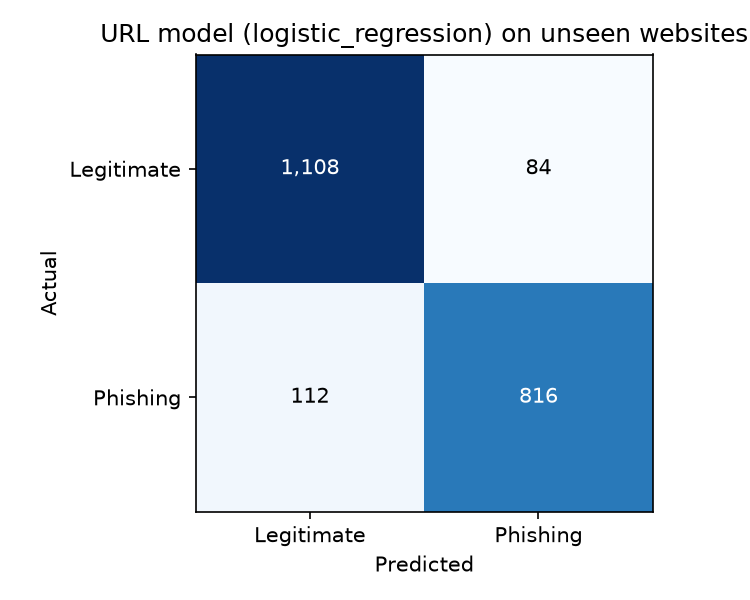
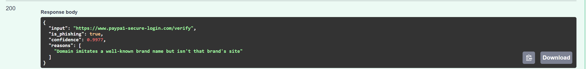
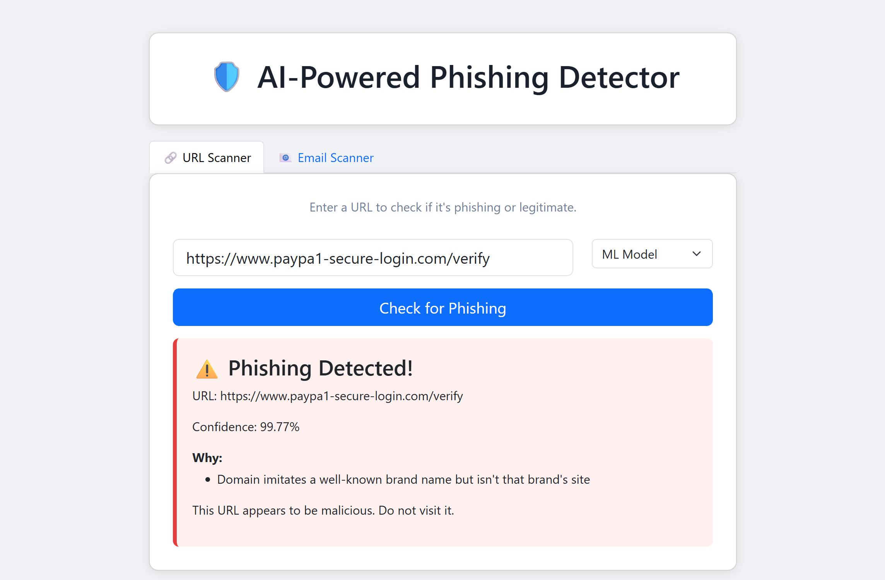
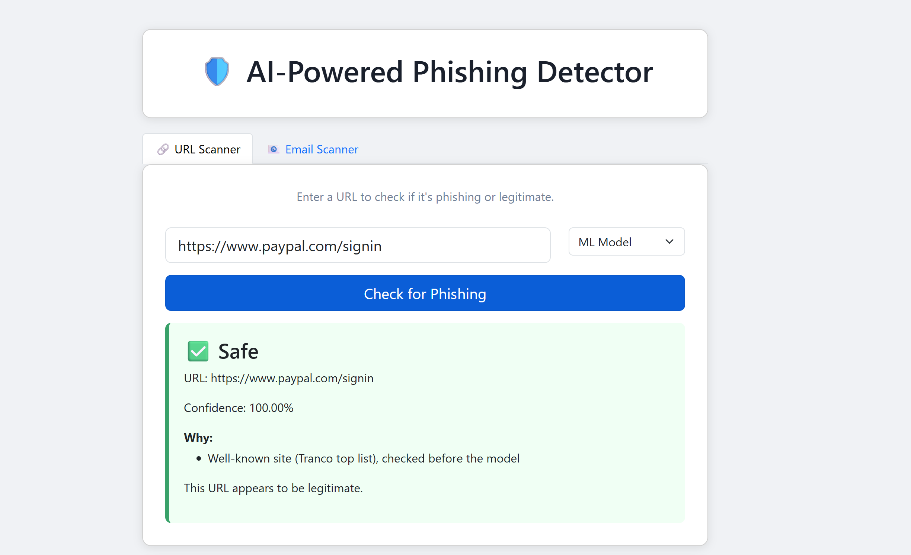
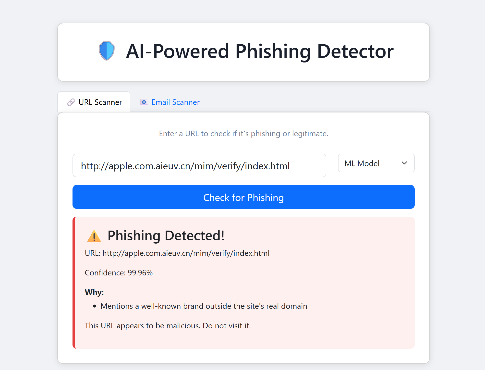
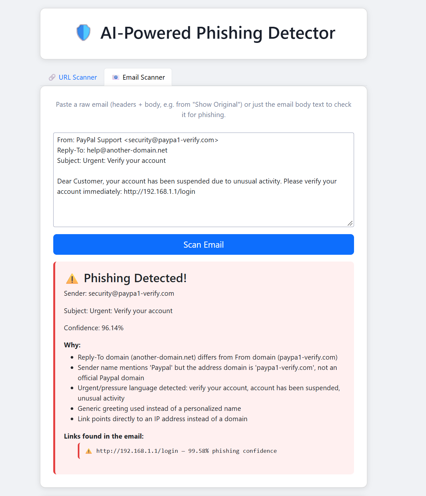
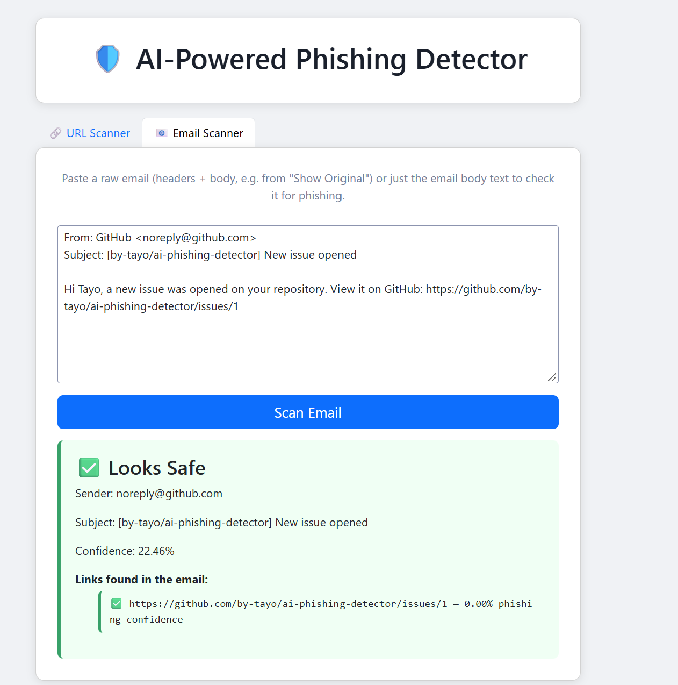

# 🛡️ AI-Powered Phishing Detector

## 📌 Overview

This project builds a **full-stack AI-powered phishing detection system** that classifies both **URLs** and **emails** as phishing or legitimate in real time.
The pipeline:

* Trains a URL classifier on a **benchmark dataset of real phishing and real legitimate URLs** (Hannousse & Yahiouche, 2021), evaluated on **websites it never saw in training**.
* Combines **character n-gram TF-IDF** with **hand-built URL features**: raw IP hosts, lookalike brand domains (`paypa1`, `chase-verify`), brand names outside the real domain (`apple.com.evil.cn`), punycode, `@` tricks and abuse-prone domain endings.
* Checks a **known-site list** (Tranco top domains and hosts) before the model, so `paypal.com/signin` isn't flagged, while free hosting, link shorteners and redirect links are never trusted.
* Trains a dedicated **email text classifier** (TF-IDF + Random Forest) on a labeled phishing/legitimate email corpus.
* Runs rule-based **email header and content heuristics** (sender/reply-to mismatches, brand impersonation, urgency language, mismatched links, IP-based links) and scores every link in the email with the URL model.
* Explains every verdict with **plain-English reasons**.
* Exposes predictions via a **FastAPI REST API** and an interactive **Plotly Dash dashboard** with URL and Email scanner tabs.
* Includes **Terraform** configuration for AWS resources.

---

## 📑 Table of Contents

1. [Project Objectives](#-project-objectives)
2. [Project Structure](#-project-structure)
3. [Dataset](#-dataset)
4. [ML Models & Results](#-ml-models--results)
5. [API Endpoints](#-api-endpoints)
6. [Frontend](#-frontend)
7. [AWS Infrastructure](#-aws-infrastructure)
8. [How to Run](#-how-to-run)
9. [Tools and Libraries](#-tools-and-libraries)
10. [Example Predictions](#-example-predictions)
11. [Known Limitations](#-known-limitations)
12. [Possible Extensions](#-possible-extensions)

---

## 🎯 Project Objectives

* Build a real-time phishing URL classifier and evaluate it honestly, on websites it has never seen.
* Combine character-level TF-IDF features with hand-built URL features that capture phishing patterns.
* Reduce false alarms on popular sites with a known-site check that attackers can't easily exploit.
* Build a real-time phishing **email** classifier combining an ML text model, header/content heuristics, and link analysis.
* Expose predictions through a documented REST API built with FastAPI.
* Build an interactive frontend dashboard using Plotly Dash.
* Provision cloud infrastructure on AWS using Terraform IaC.
* Integrate a live threat feed (OpenPhish) for real-time phishing verification.

---

## 📂 Project Structure

```text
phishing-detector/
├── backend/
│   ├── infra/                       # Terraform AWS configuration
│   │   ├── .terraform.lock.hcl      # Terraform dependency lock
│   │   ├── main.tf                  # Core AWS resource definitions
│   │   ├── outputs.tf               # Resource URLs and identifiers
│   │   ├── provider.tf              # AWS provider configuration
│   │   └── variables.tf             # Input variables
│   ├── main.py                      # FastAPI application
│   ├── model.py                     # Loads the URL model for the API
│   ├── requirements.txt             # Backend dependencies
│   └── schemas.py                   # Request/response schemas
├── ml/
│   ├── data/
│   │   ├── build_dataset.py         # Builds final_dataset.csv (URL benchmark dataset)
│   │   ├── build_top_domains.py     # Builds the Tranco known-site lists
│   │   ├── build_email_dataset.py   # Builds email_dataset.csv (Hugging Face)
│   │   ├── top_domains.txt          # Tranco top 10,000 domains (generated)
│   │   └── top_hosts.txt            # Tranco top 50,000 hosts (generated)
│   ├── models/
│   │   └── phishing-bert/           # DistilBERT configuration files (first version)
│   ├── my_dash_app_frontend/        # Plotly Dash frontend (URL + Email tabs)
│   │   ├── app.py
│   │   └── assets/style.css
│   ├── preprocess.py                # URL cleanup, features, known-site check
│   ├── train.py                     # URL model training + honest evaluation
│   ├── predict.py                   # URL prediction from the command line
│   ├── phishing_model.pkl           # URL model: one pipeline, raw URL in, verdict out
│   ├── model_metrics.json           # URL model test results (written by train.py)
│   ├── email_heuristics.py          # Email header/content heuristic analysis
│   ├── preprocess_email.py          # Email TF-IDF preprocessing
│   ├── train_email.py               # Email model training (LR, RF, XGBoost)
│   ├── evaluate_email.py            # Email text model evaluation
│   ├── predict_email.py             # Combined email prediction (text model + heuristics + links)
│   ├── email_phishing_model.pkl     # Email text Random Forest model
│   ├── email_phishing_model_xgb.pkl # Email text XGBoost model
│   ├── email_vectorizer.pkl         # Email TF-IDF vectorizer
│   ├── phishtank_api.py             # OpenPhish live feed lookup
│   ├── fine_tune.py                 # DistilBERT fine-tuning (first version)
│   ├── tokenize_data.py             # Hugging Face tokenization
│   ├── evaluate_transformer.py      # DistilBERT evaluation
│   ├── predict_transformer.py       # DistilBERT inference
│   └── model.py                     # ML model definitions
├── confusion_matrix.png             # URL model on unseen websites
├── confusion_matrix_bert.png        # DistilBERT evaluation plot (first version)
├── confusion_matrix_email_text.png  # Email text model evaluation plot
images/                              # Dashboard and API screenshots
Dockerfile                           # Docker container configuration
README.md
```

---

## 📊 Dataset

### URLs: Hannousse & Yahiouche (2021) benchmark
* Source: [`pirocheto/phishing-url`](https://huggingface.co/datasets/pirocheto/phishing-url) on Hugging Face, from *Towards benchmark datasets for machine learning based website phishing detection* (Hannousse & Yahiouche, 2021). License: CC BY 4.0.
* **11,429 URLs** after removing duplicates: **5,715 legitimate / 5,714 phishing**, from **6,634 different websites**.
* Both classes are real URLs, with paths, http and https, and with and without `www.`:

| Trait | Legitimate | Phishing |
|-------|-----------|----------|
| Has a path or query | 61.6% | 81.5% |
| Uses https | 44.5% | 33.3% |
| Starts with `www.` | 66.8% | 20.5% |

Because `www.` and https lean toward the legitimate side, and attackers can add both for free, the model **strips the scheme and `www.`** before learning from a URL.

* Labels: `1 = phishing`, `0 = legitimate`. Saved to `ml/data/final_dataset.csv` by `ml/data/build_dataset.py`.

### Known-site lists: Tranco
* [Tranco](https://tranco-list.eu/) is a research ranking of popular websites, designed to be harder to manipulate than older lists.
* `top_domains.txt`: the top 10,000 registered domains. `top_hosts.txt`: the top 50,000 full host names, from the Tranco list that includes subdomains. Each file records the Tranco list ID it came from.
* Free hosting, file sharing, form builders and URL shorteners (`blogspot.com`, `github.io`, `app.link`, `tumblr.com`, `sites.google.com`, `bit.ly`...) are removed, because anyone can publish a page there.

### Emails: Phishing Email Dataset (Hugging Face)
* Source: [`zefang-liu/phishing-email-dataset`](https://huggingface.co/datasets/zefang-liu/phishing-email-dataset), a combined Enron (legitimate) and Nazario (phishing) email corpus.
* **18,650 raw labeled emails** (`Email Text` / `Email Type`) → **17,537 after dropping nulls and duplicates** (10,979 legitimate / 6,558 phishing).
* Labels: `1 = phishing`, `0 = legitimate` (safe).
* Saved to `ml/data/email_dataset.csv`.

---

## 🤖 ML Models & Results

### URL model

**Features** (`ml/preprocess.py`):
* Character n-gram TF-IDF (`char_wb`, n = 2–5, 20,000 features), learned from the training split only
* 18 hand-built features: host and path length, subdomain depth, digits and hyphens in the host, host entropy, raw IP host, `@` in the URL, punycode, abuse-prone domain ending, lookalike brand domain, brand name outside the real domain, login/verify-style words, unusual port, `//` in the path

**Evaluation** (`ml/train.py`):
* Train and test are **split by website** (registered domain), so no site appears in both. A model can't score well just by memorizing sites.
* The model type is chosen with **5-fold cross-validation**, also grouped by website, on the training split only:

| Model | F1 (5-fold CV) |
|-------|---------------|
| **Logistic Regression** (chosen) | **0.911 ± 0.024** |
| XGBoost | 0.904 ± 0.033 |

**Held-out test: 2,120 URLs from websites never seen in training**

| Metric | Model only | With known-site check |
|--------|-----------|----------------------|
| Accuracy | 90.75% | **91.08%** |
| Precision | 90.67% | 91.47% |
| Recall | 87.93% | 87.82% |
| F1 | 89.28% | 89.61% |
| Safe URLs wrongly flagged | 84 | **76** |
| Phishing URLs missed | 112 | 113 |

The known-site check removes 8 false alarms at the cost of 1 missed phishing URL. An earlier version trusted any subdomain of a popular domain; it removed more false alarms but missed 54 more phishing URLs hosted on platforms like `app.link` and `tumblr.com`, so it was replaced with the host-level rule.



The final `phishing_model.pkl` is refit on all 11,429 URLs after evaluation. It's a single scikit-learn pipeline (URL cleanup, features and model), so there's no separate vectorizer to keep in sync. All numbers above are saved in `ml/model_metrics.json`.

### Email Text Classifier (TF-IDF + Random Forest)

Email body text was converted to features using word-level TF-IDF (`max_features=10000`, `ngram_range=(1,2)`, English stop words removed) and trained on the 17,537-email dataset above:

| Metric | Score |
|--------|-------|
| Accuracy | 97.21% |
| Precision | 95.85% |
| Recall | 96.73% |
| F1 Score | 96.29% |

XGBoost validation log-loss on the same split dropped from `0.621` at round 0 to `0.113` by round 199. The Random Forest model is used as the primary email text classifier in `/predict/email`, combined with header/content heuristics and URL-model scoring of any links found in the email (see [API Endpoints](#-api-endpoints)).

### DistilBERT Transformer (first version)

DistilBERT was fine-tuned (Google Colab, T4 GPU) on the **first version's** URL dataset, which had the formatting shortcut described above. Its 99.98% validation accuracy reflects that shortcut, not real-world performance, so it's **hidden from the dashboard** until it's retrained on `final_dataset.csv`. The `/predict/transformer` endpoint still exists, and its weights are `.gitignored`.

### Saved Model Artifacts

* `ml/phishing_model.pkl`: URL model pipeline (Logistic Regression)
* `ml/model_metrics.json`: URL model test results
* `ml/data/top_domains.txt`, `ml/data/top_hosts.txt`: known-site lists
* `ml/email_phishing_model.pkl`: Email text Random Forest model (~41 MB)
* `ml/email_phishing_model_xgb.pkl`: Email text XGBoost model (368 KB)
* `ml/email_vectorizer.pkl`: Email TF-IDF vectorizer (373 KB)
* `ml/models/phishing-bert/`: DistilBERT configuration (weights not committed)

---

## 🔌 API Endpoints

Interactive documentation is generated by FastAPI at `/docs`.

### `POST /predict`
URL prediction: the known-site check first, then the URL model. Returns plain-English reasons.

```json
// Request
{ "text": "https://www.paypa1-secure-login.com/verify" }

// Response
{
  "input": "https://www.paypa1-secure-login.com/verify",
  "is_phishing": true,
  "confidence": 0.9977,
  "reasons": ["Domain imitates a well-known brand name but isn't that brand's site"]
}
```

For a known site, the reason is `"Well-known site (Tranco top list), checked before the model"`.

### `POST /check-live`
Looks the exact URL up in the OpenPhish live phishing feed.

```json
// Request
{ "text": "http://suspicious-login.com" }

// Response
{ "url": "http://suspicious-login.com", "in_database": false, "verified": false, "source": "OpenPhish" }
```

Not being in the feed doesn't prove a URL is safe; new phishing pages appear every day.

### `POST /predict/email`
Combined email phishing prediction: merges the email text classifier, sender/header heuristics, and URL scoring of every link in the email body. Accepts a raw RFC-822 email (headers + body, e.g. pasted from "Show Original") or just plain body text.

```json
// Request
{ "raw_email": "From: PayPal Support <security@paypa1-verify.com>\nReply-To: help@another-domain.net\nSubject: Urgent: Verify your account\n\nDear Customer, your account has been suspended due to unusual activity. Please verify your account immediately: http://192.168.1.1/login" }

// Response
{
  "is_phishing": true,
  "confidence": 0.9614,
  "text_model_confidence": 0.9253,
  "heuristic_score": 1,
  "reasons": [
    "Reply-To domain (another-domain.net) differs from From domain (paypa1-verify.com)",
    "Sender name mentions 'Paypal' but the address domain is 'paypa1-verify.com', not an official Paypal domain",
    "Urgent/pressure language detected: verify your account, account has been suspended, unusual activity",
    "Generic greeting used instead of a personalized name",
    "Link points directly to an IP address instead of a domain"
  ],
  "links": [
    { "url": "http://192.168.1.1/login", "is_phishing": true, "confidence": 0.9958 }
  ],
  "sender": "security@paypa1-verify.com",
  "subject": "Urgent: Verify your account"
}
```

### `POST /predict/transformer`
DistilBERT prediction (first version; see [DistilBERT](#distilbert-transformer-first-version)). Requires the model weights and `torch`/`transformers`; the rest of the API runs without them.



---

## 🖥️ Frontend

The Plotly Dash frontend (`ml/my_dash_app_frontend/app.py`) has two tabs.

**🔗 URL Scanner**
* **URL input** and a **model selector** (ML Model or OpenPhish Live Check)
* **⚠️ Red card / ✅ green card** with the confidence and the **reasons** behind the verdict
* **Live Check** shows whether the exact URL is listed in OpenPhish

| Lookalike domain caught | Real site passes the known-site check |
|---|---|
|  |  |



**📧 Email Scanner**
* **Textarea**: paste a raw email (headers + body) or just the body text
* **Combined verdict card** with overall confidence
* **Reasons list**: the heuristic flags that were triggered (sender/reply-to mismatch, brand impersonation, urgency language, mismatched or IP-based links)
* **Per-link results**: every URL in the email, scored individually

| Phishing email | Normal email (was a false alarm in the first version) |
|---|---|
|  |  |

The **How it works** section reads `ml/model_metrics.json`, so the numbers on the page always match the trained model.

---

## ☁️ AWS Infrastructure

AWS resources are defined with **Terraform** (Infrastructure as Code):

| AWS Resource | Details |
|-------------|---------|
| IAM Role | ECS task role |
| VPC | Isolated network |
| S3 Bucket | ML model artifact and log storage |
| ECR Repository | Container image registry for the API |
| ECS Cluster | Cluster for running the API container |
| RDS MySQL 8.0 | Planned scan history database (`db.t3.micro`, 20 GB) |

### Terraform Commands

```bash
cd phishing-detector/backend/infra
terraform init      # Initialize providers
terraform plan      # Preview changes
terraform apply     # Deploy infrastructure
terraform destroy   # Tear down infrastructure
```

---

## ⚙️ How to Run

### Prerequisites
* Python 3.12+
* Linux, WSL (Ubuntu) or GitHub Codespaces
* AWS CLI and Terraform (only for the infrastructure)

### 1. Install dependencies
```bash
pip install -r phishing-detector/backend/requirements.txt
```
`torch` and `transformers` are only needed for the DistilBERT endpoint and training.

### 2. Build the datasets and known-site lists
```bash
python3 phishing-detector/ml/data/build_dataset.py
python3 phishing-detector/ml/data/build_top_domains.py
cd phishing-detector && python3 ml/data/build_email_dataset.py && cd ..
```

### 3. Train the models
```bash
python3 phishing-detector/ml/train.py
cd phishing-detector && python3 ml/train_email.py && cd ..
```
`train.py` prints cross-validation results, the held-out test (with and without the known-site check) and a set of hard cases, then saves `phishing_model.pkl`, `model_metrics.json` and `confusion_matrix.png`.

Check a single URL from the command line:
```bash
python3 phishing-detector/ml/predict.py "https://www.paypa1-secure-login.com"
```

### 4. Start the FastAPI backend
```bash
cd phishing-detector/backend
uvicorn main:app --reload --port 8000
```
* Swagger docs: `http://localhost:8000/docs`

### 5. Start the Dash frontend
In a second terminal:
```bash
cd phishing-detector/ml/my_dash_app_frontend
python3 app.py
```
* Dashboard: `http://localhost:8050` (in Codespaces, open port 8050 from the **Ports** tab)
* Set `API_URL` if the API runs somewhere other than `http://127.0.0.1:8000`, and `DASH_DEBUG=1` for Dash's developer tools.

---

## 🛠 Tools and Libraries

* **Python 3.12**: core language
* **Scikit-learn**: Logistic Regression, Random Forest, TF-IDF, pipelines, grouped cross-validation, metrics
* **XGBoost**: gradient boosting classifier
* **tldextract**: finds a URL's real (registered) domain
* **Tranco**: research ranking of popular websites for the known-site check
* **Hugging Face Datasets**: downloads the URL and email datasets
* **Hugging Face Transformers / PyTorch**: DistilBERT fine-tuning and inference
* **FastAPI / Uvicorn**: REST API
* **Plotly Dash / Dash Bootstrap Components**: interactive dashboard
* **Pandas / NumPy**: data processing
* **Matplotlib / Seaborn**: evaluation plots
* **Joblib**: model serialization
* **Requests**: OpenPhish lookups
* **Terraform / AWS CLI**: infrastructure as code
* **Google Colab (T4 GPU)**: DistilBERT training
* **GitHub Codespaces, Cursor IDE, WSL (Ubuntu)**: development environments

---

## 🧪 Example Predictions

URL results from the current model (`ml/train.py` hard cases, with the known-site check):

| URL | Result | Phishing score | Why |
|-----|--------|---------------|-----|
| `https://www.paypa1-secure-login.com` | ⚠️ Phishing | 96.7% | Lookalike brand domain |
| `https://www.chase-verify-account.com` | ⚠️ Phishing | 98.0% | Brand name in a domain that isn't the brand's |
| `http://apple.com.aieuv.cn/mim/verify/index.html` | ⚠️ Phishing | 100.0% | Brand name outside the real domain (`aieuv.cn`) |
| `http://192.168.1.1/login` | ⚠️ Phishing | 99.4% | Raw IP address |
| `https://secure-update-billing.xyz/netflix/login.php` | ⚠️ Phishing | 100.0% | Abuse-prone ending, brand in path, login words |
| `https://www.paypal.com/signin` | ✅ Safe | 0.0% | Known site |
| `https://accounts.google.com` | ✅ Safe | 0.0% | Known site |
| `https://github.com/by-tayo/ai-phishing-detector` | ✅ Safe | 0.0% | Known site |
| `https://www.amazon.com/gp/your-account/order-history` | ✅ Safe | 0.0% | Known site |
| `https://www.utsa.edu/` | ✅ Safe | 2.4% | Model |
| `https://docs.python.org/3/library/email.html` | ⚠️ Phishing (wrong) | 81.0% | See [Known Limitations](#-known-limitations) |

The first version flagged the GitHub, Amazon, Python docs, PayPal and Google URLs above as phishing and passed both lookalike domains (`paypa1-secure-login`, `chase-verify-account`) as safe. The current model gets 10 of these 11 right.

---

## 🚧 Known Limitations

* **URL text only.** The URL model never visits the page, so it can't see page content, certificates, or domain age. A clean-looking URL on an attacker's own domain can still pass.
* **Content on trusted sites.** Phishing posted on a real, popular site (a shared Evernote note, an Instagram profile, an OAuth consent page on `login.microsoftonline.com`) passes the known-site check.
* **Less popular legitimate subdomains.** The known-site check only trusts hosts in the Tranco top 50,000. Others, like `docs.python.org`, go to the model, which can be wrong (81% phishing).
* **Dataset age and size.** The URL dataset is from 2021 and has about 11,000 URLs. Newer phishing patterns may be missed.
* **Email dataset.** Legitimate emails come from Enron (around 2001) and phishing from the Nazario corpus, so the text model may partly be learning the difference between eras. Modern newsletters and receipts should be tested.
* **DistilBERT** hasn't been retrained on the new URL dataset yet.

---

## 🚀 Possible Extensions

* Retrain DistilBERT on `final_dataset.csv` and compare it with the current model on the same website-grouped test.
* Train on a larger, more recent URL dataset combining multiple phishing sources.
* Add page-level signals (domain age, TLS certificate, page content) on top of the URL model.
* Evaluate the email model on modern legitimate email and add SPF/DKIM/DMARC checks from the `Authentication-Results` header.
* Build a Chrome extension that checks links using this API.
* Pin exact package versions in `requirements.txt` so saved models always load with the version they were trained on.
* Fix the Dockerfile paths, and lock down the Terraform configuration (private RDS, encryption at rest).
* Integrate the RDS MySQL database to log prediction history and build a scan dashboard.
* Add rate limiting on the FastAPI endpoints and GitHub Actions CI for automated testing.
